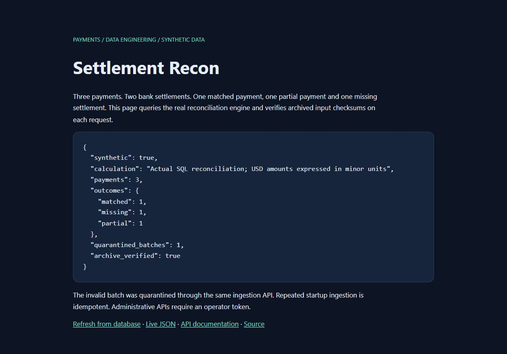
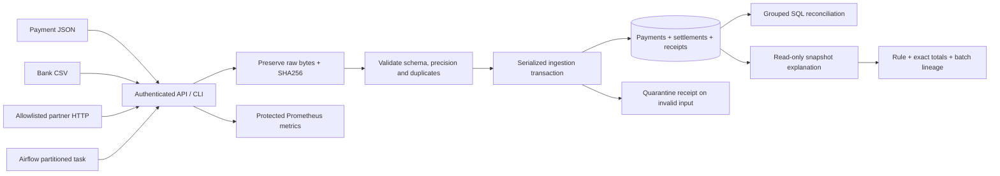

# Settlement Recon

**Latest portfolio verification (5 Nov 2026):** PipeFoundry's real Gemini 3.1 inference and automatic 3.5-to-3.1 recovery were verified on public HTTPS; DataGuard uses the healthy free 3.1 pool. [Live proof, restored configuration, all-app retests and account blocker](docs/backup-live-verification.md).

**Earlier AI recovery release (5 Nov 2026):** Shared transient retries, deadline checks and correct provider cooldowns are deployed. [Hosted test receipts, live retests, free-model fallback scope and GitHub account blocker](docs/ai-recovery-release.md).

**Earlier hosted build-gate release (5 Nov 2026):** 222 tests passed, 6 explicit optional skips on the actual Linux builder. Every release image depends on a successful verification receipt. [Build logs, public retests and exact GitHub/AWS blockers](docs/free-hosted-ci.md).

[OpenFX readiness audit](docs/openfx-interview-readiness.md) · [Interview demonstration](docs/interview.md)

**Explain payment mismatches. Investigate allocation ambiguity. Preserve the evidence.**

A Python and SQL reconciliation workspace for operator-supplied payment records and traceable public currency reference data. It joins payment events with bank statements, accounts for fees in exact currency minor units, and explains why a payment is matched, partial, missing, overpaid or orphaned. Every accepted or quarantined batch retains its original input checksum.

[Live console](https://rohith-settlement-recon.vercel.app/demo) · [API documentation](https://rohith-settlement-recon.vercel.app/docs) · [Reference-rate provenance](https://rohith-settlement-recon.vercel.app/workspace/provenance) · [Readiness](https://rohith-settlement-recon.vercel.app/readyz) · [Verification](VERIFICATION.md)

**Stack:** Python · FastAPI · SQLAlchemy · PostgreSQL · Airflow integration · S3-compatible archival · Docker · Terraform · Prometheus

[OpenFX Data Engineering and DevOps requirement coverage](docs/openfx-jd-coverage.md) links the four projects to executed workflows, measured results, and the remaining account blockers.

## The engineering problem

A payment API returning success does not prove the money was settled correctly. Statements can arrive late, split one payment across several rows, deduct fees, repeat a previously delivered file, or contain a conflicting identifier. A useful reconciliation system must distinguish those cases and preserve enough evidence to investigate them.

Settlement Recon treats **correctness, provenance and recovery** as the product. The public deployment runs the actual Docker backend against durable PostgreSQL on Vercel Hobby and Neon Free. Its public workspace uses captured live reference data; financial records remain authenticated. Legacy synthetic fixtures are disabled in production.

## Five capabilities worth reviewing

1. **Exact financial rules with explicit currency boundaries.** Decimal strings become integer minor units. Net settlement plus fee is compared with the original payment; EUR never silently settles USD. USD/EUR/GBP/INR use two decimal places, JPY uses zero. [Rules and tests](tests/test_domain.py)
2. **Explainable decisions and ambiguity-aware investigation.** Authenticated explanations return exact rules, totals and bounded source receipts from one snapshot. Settlement Forensics additionally derives residual obligations and orphan legs from SQL, then searches all optimal allocations; ties abstain instead of inventing a confident link. [Explanation](src/settlement_recon/explanation.py) · [Allocation engine](src/settlement_recon/forensics.py)
3. **Replay safety across workers and restarts.** A batch is identified by kind, source and content checksum. PostgreSQL advisory transactions serialize writers; unique business keys reject conflicting duplicates. An identical replay returns its original receipt. [Concurrent PostgreSQL tests](tests/test_postgres.py)
4. **Quarantine without partial financial effects.** Parsing, schema, precision and duplicate checks gate the whole batch. Invalid inputs remain archived, but create no payment or settlement rows. A corrected file creates a new receipt; it does not rewrite the rejected evidence. [Failure and recovery tests](tests/test_archive.py)
5. **An operated, reproducible backend.** Digest-pinned nonroot containers, protected metrics, bounded requests, schema startup locks, strict hosted database TLS and persistent raw archival support real public releases. AWS ECS/RDS/S3 infrastructure and an Airflow DAG are supplied separately with their execution boundaries documented. [Deployment profile](docs/public-deployment.md)

<details>
<summary>See the actual public console</summary>



</details>

## Architecture



The hosted profile stores both records and content-addressed raw bytes in PostgreSQL. Local development can use SQLite and files; the AWS profile uses PostgreSQL and encrypted S3. These are explicit storage adapters around the same ingestion boundary.

### The invariant behind the result

```text
settled_minor    = SUM(net_minor + fee_minor)
difference_minor = expected_minor - settled_minor
```

| Outcome | Meaning within one payment/currency group |
|---|---|
| Matched | At least one settlement row; settled amount equals expected amount |
| Partial | Settled amount is below the expected amount |
| Missing | A payment exists, with no settlement rows in its currency |
| Overpaid | Settled amount exceeds the expected amount |
| Orphan | Settlement rows exist without a payment in that currency |

A zero-valued payment with no settlement rows remains missing. Refunds and negative adjustments are rejected until they have an explicit record model. There is no inferred FX conversion.

## Run the local demonstration

Python 3.12+ is supported; the pinned release container runs Python 3.15.1. The CLI demonstration needs no cloud account or operator token and uses SQLite plus files under `data/`.

```bash
git clone https://github.com/9059Rohith/settlement-recon.git
cd settlement-recon
python -m venv .venv
```

**Windows PowerShell:**

```powershell
.venv\Scripts\python.exe -m pip install -r requirements.txt
.venv\Scripts\python.exe -m pip install --no-deps -e .
.venv\Scripts\python.exe -m settlement_recon.cli demo
.venv\Scripts\python.exe -m settlement_recon.cli explain demo-partial INR --limit 5
```

<details>
<summary>Linux / macOS commands</summary>

```bash
.venv/bin/python -m pip install -r requirements.txt
.venv/bin/python -m pip install --no-deps -e .
.venv/bin/python -m settlement_recon.cli demo
.venv/bin/python -m settlement_recon.cli explain demo-partial INR --limit 5
```

</details>

Selected fields from the explanation of the built-in INR fixture:

```json
{
  "status": "partial",
  "totals": {
    "expected_minor": 100000,
    "net_minor": 59000,
    "fee_minor": 1000,
    "settled_minor": 60000,
    "difference_minor": 40000
  },
  "archive_integrity_checked": false
}
```

The full response includes the rule, source receipts, bank legs, evidence limit and snapshot type. Referencing an input checksum is distinct from reading and re-verifying the archived object; use `verify <batch_id>` for that operation.

### PostgreSQL and the HTTP API

```bash
python scripts/setup_env.py
docker compose up -d --build
docker compose exec api settlement-recon demo
docker compose exec api settlement-recon explain demo-partial INR --limit 5
```

The local API is at `http://127.0.0.1:8011/docs`. Enter the locally generated `API_TOKEN` using **Authorize**. Setup refuses to overwrite an existing `.env`; keep that file private. The public console requires no token, while private operations do.

## Signature capability: Settlement Forensics

Investigate unlinked bank legs using **all-optimal allocation consensus**, rather than selecting an arbitrary nearest amount. Candidate groups must satisfy an explicit currency, integer tolerance, reference and calendar-window policy. A bounded component-wise exact solver first maximizes matched payment count, then the declared evidence preferences. A suggestion is returned only when its allocation agrees across every optimum; ambiguous or exhausted components abstain. Suggestions never modify the ledger.

The distinction matters: two identical payments and two identical bank legs have two equally good allocations. Returning the lexicographically first would invent certainty. The solver reports ambiguity, and the tests compare small problems with an independent exhaustive oracle. A unique mathematical optimum can still be a false business match when identifying evidence is absent.

```powershell
# No database or credentials required for a local, synthetic investigation.
settlement-recon forensics examples/forensics.json
python scripts/evaluate_forensics.py --trials 40
```

The protected HTTP equivalent is `POST /v1/forensics/analyze`, with the [example request](examples/forensics.json). `GET /v1/forensics/case?payment_id=YOUR_ID&source=YOUR_BANK_SOURCE` extracts selected positive residual obligations and orphan bank legs from the real database in one read-only snapshot. It preserves source receipts and excludes already-linked legs; extraction also leaves the ledger unchanged. Feed the returned `case` into analysis after reviewing its evidence limitations.

| Designed synthetic study, 40 trials × 8 scenarios | Exact-allocation precision | Payment coverage | False suggestions |
|---|---:|---:|---:|
| Default evidence policy | 90.91% | 68.75% | 40 |
| Require complete matching references | 100% | 50% | 0 |

[Raw study, per-scenario results and timings](evidence/forensics-evaluation.json). Labels never enter the solver. These are designed synthetic strata, not production accuracy estimates: the deliberately indistinguishable decoy exposes why amount/date agreement is inadequate. Stricter evidence trades coverage for fewer false suggestions; no probability score or trained model is implied.

The analysis caps requests at 24 payments / 32 legs, splits at three, connected components at 10 payments / 16 legs, enumeration at 10,000 candidates and 150,000 combinations, and memoized search at 50,000 states with a two-second wall budget. The API authenticates before reading bodies, limits them to 128 KB / five seconds, rejects duplicate keys and deep structures, redacts invalid input and limits concurrent investigations to two. Exhaustion is explicit. A source with more than 32 orphan legs is rejected rather than silently sampled.

[Allocation engine](src/settlement_recon/forensics.py) · [Exact solver](src/settlement_recon/forensics_solver.py) · [SQL case extraction](src/settlement_recon/forensics_case.py) · [Failure/oracle tests](tests/test_forensics.py) · [Snapshot tests](tests/test_forensics_case.py)

## API surface

| Method | Route | Contract |
|---|---|---|
| POST | `/v1/ingest/payments?source=ledger` | Payment JSON → accepted, replayed or quarantined receipt |
| POST | `/v1/ingest/statement?source=bank` | Bank CSV → durable receipt |
| GET | `/v1/reconciliation` | Exact amounts and exception status; at most 10,000 groups |
| GET | `/v1/reconciliation/{payment_id}/{currency}/explanation?limit=25` | Typed rule, totals and bounded original-input lineage |
| GET | `/v1/batches` | Latest 100 receipts and diagnostics |
| GET | `/v1/batches/{id}/verify` | Re-read and verify archived input |
| GET | `/metrics` | Protected HTTP and ingestion metrics |
| POST | `/v1/forensics/analyze` | Advisory bounded allocation, ambiguity and optimality report |
| GET | `/v1/forensics/case?payment_id=ID&source=BANK` | Snapshot-consistent residual obligations and orphan-leg evidence |

All routes in this table require a bearer token. An optional reader token can inspect evidence but cannot ingest. Missing or short writer credentials fail closed.

Uploads are limited to 2 MB and 10,000 rows; authenticated uploads have a ten-second read deadline. Monetary values and cumulative settlement totals are bounded to `10^15` minor units. A quarantined batch can return HTTP 200 because its receipt was persisted successfully: inspect the receipt's `status`.

Explanation totals include the entire currency group. Returned legs default to 25 and cap at 100, with an explicit `truncated` flag. PostgreSQL uses a read-only REPEATABLE READ transaction; SQLite uses an explicit read transaction. Missing, wrong-kind or nonaccepted receipt lineage fails closed, including rows beyond the evidence limit.

## Walk through a failure

| Step | Operation | Expected behavior |
|---|---|---|
| Ingest | Upload payment JSON and the bank CSV in `examples/` | Receipts name the original inputs; amounts use integer minor units |
| Replay | Submit identical kind/source/bytes again | Original batch ID, `replayed=true`; no duplicate financial effects |
| Corrupt | Ingest a statement containing `corrupt statement` | Quarantined receipt; no partial business writes |
| Correct | Fix the input bytes and ingest again | New checksum and receipt; rejected input remains archived |
| Investigate | Explain the payment/currency, then verify its referenced receipts | Exact rule and source lineage; raw-object integrity is checked separately |

The built-in `demo` performs accepted, partial, quarantined and replayed cases. [Archive failures](tests/test_archive.py), [explanation corruption/snapshot checks](tests/test_explanation.py) and [cross-process replay](tests/test_postgres.py) make these behaviors executable.

## Evidence and measurements

| Question | Inspect |
|---|---|
| Did the full native container suite run against PostgreSQL and encrypted MinIO? | [Executed runtime test log](evidence/public-runtime-tests.txt) |
| Does explanation remain consistent when another connection commits a settlement? | [SQLite and PostgreSQL snapshot tests](tests/test_explanation.py), [PostgreSQL test](tests/test_postgres.py) |
| Can a hidden bank leg have missing provenance? | [Full-group lineage regression](tests/test_explanation.py) |
| Did public authentication and replacement recovery work? | [Public checks](evidence/public-release-verification.json), [deployment identity](evidence/public-deployment.json) |
| Were image vulnerabilities and committed secrets checked? | [Current image scan](evidence/signature-image-scan.json), [source secret scan](evidence/review-source-secret-scan.json) |
| What is configured versus actually executed? | [Verification ledger](VERIFICATION.md) |

The current 1,000-payment PostgreSQL run used Python 3.12.0 on Windows-to-Docker TCP, 30 warm samples per operation, exact correctness assertions and no concurrent request load:

| Operation | p50 | p95 | p99 |
|---|---:|---:|---:|
| Reconciliation | 113.188 ms | 152.209 ms | 162.219 ms |
| Identical-batch replay | 41.324 ms | 71.664 ms | 77.337 ms |
| One-payment explanation | 21.294 ms | 31.770 ms | 33.672 ms |

[Raw current samples and methodology](evidence/benchmark-explanation-postgres.json); [retained earlier baseline](evidence/benchmark-postgres.json). These are small local measurements, not public HTTP latency, production throughput or availability guarantees. Concurrent verification work ran on the shared workstation. The current benchmark scopes generated IDs before the result cap; [the regression](tests/test_evaluation.py) prevents unrelated historical rows from corrupting its results. Cross-run timing differences do not establish a general speedup.

To reproduce checks in an activated development environment:

```bash
python -m pip install -r requirements-dev.txt
python -m pip install --no-deps -e .
python -m pytest
python -m ruff check src tests scripts
python -m ruff format --check src tests scripts
python -m bandit -r src -ll
python -m pip_audit -r requirements.txt
python scripts/evaluate.py --rows 1000
```

Set `TEST_DATABASE_URL` and the S3-compatible test credentials to execute those integrations; their absence produces explicit skips. [Native runtime verification instructions](docs/public-deployment.md#verify-the-actual-runtime) cover the pinned Python 3.15 image. The configured [GitHub Actions workflow](https://github.com/9059Rohith/settlement-recon/actions/workflows/ci.yml) is subject to an account-level runner restriction; executed local/container evidence is linked above.

## Deployment scope and tradeoffs

| Surface | Status | Deliberate boundary |
|---|---|---|
| Vercel Docker API + Neon PostgreSQL | Public, verified | Published ECB observations, protected financial operations, free quotas and cold starts |
| Local PostgreSQL + encrypted MinIO | Integration-tested | S3-compatible behavior, not proof of AWS IAM configuration |
| Airflow DAG | Actual older-runtime import verified; current CI configured | No live scheduler is claimed |
| AWS ECS / ALB / RDS / S3 / ECR / IAM | Terraform validated; apply not executed | Requires account credentials, certificate, secrets and budget |
| Prometheus rules / Grafana dashboard | Exporter exercised; deployment artifacts supplied | Independent monitoring servers are not running in the free host |

The [Fargate compute check](docs/fargate-compute-cost.md) compares the Terraform task size against the live AWS catalog and can enforce a CPU and memory budget threshold.

- **Correctness before parallel write throughput.** A global writer lock makes duplicate and cumulative-amount decisions easy to defend; it limits write concurrency.
- **Evidence before cross-store atomicity.** Raw archival precedes the financial transaction. A crash between them may leave an unreferenced object; retry safely reuses its checksum.
- **Bounded synchronous work.** The API returns a durable receipt rather than relying on a process-local background queue. Large reconciliations need an offline/export or pagination extension.
- **A defined financial model.** Fees are deducted from proceeds. Negative adjustments, chargebacks, FX conversion and a complete accounting ledger need additional explicit models.
- **A clear security boundary.** Strong shared operator tokens, strict hosted TLS, isolated database roles, input limits and a minimal nonroot image are implemented. Per-user OIDC and a custom distributed rate limiter are future work. Database checksums do not defend against a compromised database owner.

## Reviewer and interview guide

Start with [the matching rules](src/settlement_recon/domain.py), follow [the explanation read snapshot](src/settlement_recon/explanation.py), then inspect [failure-oriented tests](tests/test_explanation.py). The useful questions are why writers are serialized, why an input can be quarantined after successful archival, and what a checksum proves.

[Architecture / ADRs](docs/architecture.md) · [Runbook](docs/runbook.md) · [Security model](SECURITY.md) · [Role-to-evidence matrix](docs/traceability.md) · [Interview questions and answers](docs/interview.md)

Companion projects explore the adjacent problems: [FluxLake](https://github.com/9059Rohith/fluxlake) for mutable CDC history, [DataGuard](https://github.com/9059Rohith/dataguard) for safe dataset publication, and [PipeFoundry](https://github.com/9059Rohith/pipefoundry) for deployment automation.

Original implementation informed by [PostgreSQL snapshot isolation](https://www.postgresql.org/docs/current/transaction-iso.html), [Airflow rerun guidance](https://airflow.apache.org/docs/apache-airflow/stable/best-practices.html), [AWS ELT patterns](https://github.com/aws-samples/sample-mwaa-elt-ingestion-glue-rds) and [S3 conditional writes](https://docs.aws.amazon.com/AmazonS3/latest/userguide/conditional-writes.html). References are design inputs, not repositories claimed as original work.

[MIT license](LICENSE).

The new explanation route also passed [protected public HTTPS checks](evidence/review-public-feature.json), including exact partial totals, valid source receipts, denied anonymous access, bounded input and its typed OpenAPI response.

Current signature release: [actual protected HTTPS checks](evidence/signature-public-feature.json), [all-severity runtime scan](evidence/signature-image-scan.json), and [measured code changes](evidence/signature-code-metrics.json). Application, test and operational-script lines are counted separately; documentation, comments and docstrings are excluded.


## Multipage operations workspace

Twelve dedicated pages are available under `/workspace/`: overview, rates, converter,
payments, settlements, reconciliation, exceptions, ingest, batches, provenance, agent,
and operations. The navy/blue ledger interface is responsive, keyboard navigable,
and renders provider and source values through safe text nodes.

The public rate integration calls `https://api.frankfurter.dev/v1/latest`, validates
currency codes and finite positive decimal observations, stores the canonical payload
with SHA256 and a separate capture timestamp in PostgreSQL, and supports exact
cross-rate calculations. These are reference observations, not executable bank prices.
Provider refresh is writer-only, bounded by a timeout and a one-minute worker cooldown.
An outage returns a failure and retains the previous dated observation.

Financial workflows accept actual operator JSON/CSV through the existing authenticated,
replay-safe ingestion engine. The UI supports file-size checks, quarantine receipts,
reconciliation, separate ledger/settlement tables, and archive verification. Legacy sources are excluded through an explicit `operator:` source namespace; new workspace uploads use that namespace. Old synthetic
source rows remain isolated from workspace views; no real bank account is connected.
Tokens are held only in page memory; navigation intentionally ends that page session.

The investigation agent implements a genuine bounded provider function-calling loop
with two allowlisted read-only evidence tools, a maximum of three rounds and four calls
per round, and explicit upstream errors. Production uses Google Gemini 3.5 Flash-Lite through a server-only `GEMINI_API_KEY`,
restricted to the Generative Language API in a dedicated Google project with billing
disabled. It never falls back to a paid provider. The original OpenAI adapter remains
available only when Gemini is not configured. Missing credentials and exhausted
free-tier quota return explicit errors. No generated answer is substituted.
Only public reference observations and integration metadata are exposed to the
model; private financial rows are outside its tool allowlist.

### Current verification and limits

The Gemini integration suite passed 153 tests with six explicit PostgreSQL/S3 skips
while the local integration services were stopped; dated evidence records each run. `tests/test_workspace.py` covers
all twelve pages, auth boundaries, exact conversion, provider payload validation,
provenance persistence and refresh cooldown. Controlled responses in tests are isolated
test fixtures, never runtime fallback data. Dependency audit and live HTTP evidence are
stored in `evidence/`. Existing AWS Terraform and Airflow files remain integration
configurations; this release does not provision AWS or run a live scheduler.

For an OpenFX interview, demonstrate a real source upload, its immutable batch receipt,
a replay returning the same result, an invalid file being quarantined, and the difference
between source observation time and ingestion time. Explain which operations require a
writer and why reference prices must never be presented as settlement proof.


### Final service-backed verification

Before the Gemini provider addition, the complete suite passed **157 tests with
zero skips** after starting the installed Docker runtime against local PostgreSQL and encrypted MinIO S3-compatible storage
(`evidence/workspace-integration-tests.txt`). This includes concurrent replay, exact
reconciliation, archived-byte verification, schema startup locking, PostgreSQL evidence
extraction, and all workspace regression cases. The earlier skipped-service run remains
as dated intermediate evidence. The newer Gemini tests were run separately; a skipped
service test is not evidence that the service was exercised in that newer run.
No hosted application database was used for destructive tests. The previously missing AI credentials have since been resolved through the verified
Gemini free-tier integration below; live financial ingestion still needs an actual
authorized input source. Public views contain captured FX observations only.


## Live AI provider integration

Google Gemini `gemini-3.5-flash-lite` is the current live model. Its chat-completions
adapter preserves opaque provider tool-call metadata across turns, requires evidence
tool use before answering, validates tool names and arguments, and allows at most
three model rounds. Outputs include the actual tool evidence and provider/model name.
The Google project `rohith-openfx-ai-free-261102` has billing disabled, and each portfolio
application has a distinct API key restricted to `generativelanguage.googleapis.com`.
Free-tier quotas are finite and can return 429; no card, paid fallback, Google Search
or paid grounding tool is configured. Google unpaid API data-use terms apply, so the
agent's automatic tools expose only public FX data and non-secret integration state.

Live verification asks the model to call `reference_rates` and `service_status`, then
checks its returned observation date, EUR/USD quote, source digest and bank-feed status
against the actual persisted snapshot. `evidence/gemini-live-local.json` records the
real provider-backed tool loop. `evidence/gemini-live-production.json` records the
actual hosted HTTP 200 response, and `evidence/gemini-browser.png` plus the sanitized
DOM transcript verify the operator UI workflow. Unit tests
cover provider routing, thought-signature roundtrips, key non-disclosure and quota errors.
Use the existing operator token on the Investigation agent page to run an investigation.


## Token-free recruiter AI demo

[Open the public investigator](https://rohith-settlement-recon.vercel.app/workspace/agent).
The default form calls `POST /workspace/api/agent/demo` without operator credentials.
Only the actual captured public FX observation and non-secret integration status are
available to this read-only Gemini investigation. Ledger records, uploads, refreshes,
reconciliation and the original operator endpoint retain their authorization checks.
Do not enter private information: unpaid Gemini service data-use terms apply.

Public budgets use atomic conditional upserts in the existing PostgreSQL database:
three investigations per client per fixed 10-minute window, two global starts per
minute, and thirty global starts per UTC day. Counters survive restarts and workers;
SQLite is supported for local tests only. Production fails closed if persistent
budget storage is unavailable. Rejected budgets return `429` and `Retry-After`
before inference. Accepted attempts count even if the upstream provider fails.
IP identities are HMACed with the existing server secret, never stored as raw IPs;
expired counters are pruned after one day. Only a configured Vercel deployment trusts
Vercel's overwritten forwarding header. Direct local servers use their socket peer.
Explicit foreign browser origins are rejected. Free quotas are finite and shared
with the other portfolio apps, and no paid fallback is used for the demo.

Public requests permit only a 5–600 character question; unknown request fields are
rejected. The model has a 900-token output cap per turn, three model rounds, and
at most four fixed evidence calls per round. Tests cover anonymous tool execution,
parallel budget consumption, persistent cooldowns, global daily limits, spoofed
forwarding headers, blocked private operations, input validation and fail-closed
storage errors. Runtime answers are provider-generated; unit-test responses are
isolated test fixtures.


## Evidence-first product interface

The twelve-page workspace has a new financial design system, a live reference-market
view, searchable/sortable observations, source-inspection drawers, exact currency
conversion, keyboard page navigation and a safely formatted public AI investigation
workspace. All displayed market values come from the real captured source; protected
financial records are never filled with synthetic portfolio metrics.

[Design and interaction decisions](docs/ui-redesign.md). Manrope is bundled under
its included SIL Open Font License, so the UI does not depend on a third-party font
request. The financial API, authentication and public AI quota policy remain intact.


## New: FX Exposure Stress Lab

[Open the decision lab](https://rohith-settlement-recon.vercel.app/workspace/treasury) · [Method and interview guide](docs/treasury-stress-lab.md)

Move from reference-rate lookup to reproducible treasury analysis:50 visitor-authored cash flows,8 independent scenarios, gross/net currency exposure, exact-rational valuation, per-currency contribution and absolute exposure-limit checks. Captured ECB provenance, typed assumptions and SHA256 report identity travel together in a downloadable artifact. The polished13-page workspace keeps customer records protected. Scenarios are hypothetical, never represented as actual payments, forecasts or VaR.

The new release passed192local Python tests (6optional integration skips) and4Node cases; bounded50-flow/8-scenario analysis measured6.36ms p50 /10.12ms p95 locally, excluding HTTP/DB. See the method for measurement scope and limitations.

### Real market replay

[Historical FX replay](https://rohith-settlement-recon.vercel.app/workspace/history) derives exact cross-rates from the original ECB archive. The reproducible benchmark independently verified 54,464 pair observations across 214 windows. See [method and measured results](docs/ecb-replay.md).

### Current cross-project reliability verification

The latest DataGuard, FluxLake, and PipeFoundry fixes were staged and promoted. All four public apps passed 14 API checks and eight browser workflows at mobile and desktop widths. [Release evidence, fault cases, and interview notes](docs/openfx-reliability-release.md)
