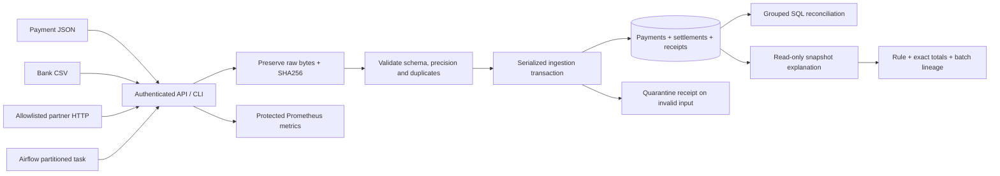

# Settlement Recon

**Explain every payment mismatch. Replay every input safely. Keep the evidence.**

A Python and SQL reconciliation service for synthetic cross-border payments. It joins payment events with bank statements, accounts for fees in exact currency minor units, and explains why a payment is matched, partial, missing, overpaid or orphaned. Every accepted or quarantined batch retains its original input checksum.

[Live console](https://rohith-settlement-recon.vercel.app/demo) · [API documentation](https://rohith-settlement-recon.vercel.app/docs) · [Live JSON](https://rohith-settlement-recon.vercel.app/demo/summary) · [Readiness](https://rohith-settlement-recon.vercel.app/readyz) · [Verification](VERIFICATION.md)

**Stack:** Python · FastAPI · SQLAlchemy · PostgreSQL · Airflow integration · S3-compatible archival · Docker · Terraform · Prometheus

## The engineering problem

A payment API returning success does not prove the money was settled correctly. Statements can arrive late, split one payment across several rows, deduct fees, repeat a previously delivered file, or contain a conflicting identifier. A useful reconciliation system must distinguish those cases and preserve enough evidence to investigate them.

Settlement Recon treats **correctness, provenance and recovery** as the product. The public deployment runs the actual Docker backend against durable PostgreSQL on Vercel Hobby and Neon Free. Its public view uses a fixed synthetic fixture; operator APIs remain authenticated.

## Five capabilities worth reviewing

1. **Exact financial rules with explicit currency boundaries.** Decimal strings become integer minor units. Net settlement plus fee is compared with the original payment; EUR never silently settles USD. USD/EUR/GBP/INR use two decimal places, JPY uses zero. [Rules and tests](tests/test_domain.py)
2. **Explainable results with source lineage.** An authenticated explanation returns the matching rule, complete monetary totals, the payment receipt, and up to 100 deterministically ordered bank legs with source batch IDs and SHA256 checksums. Three SELECTs share one read snapshot; truncating evidence never truncates the totals. [Implementation](src/settlement_recon/explanation.py)
3. **Replay safety across workers and restarts.** A batch is identified by kind, source and content checksum. PostgreSQL advisory transactions serialize writers; unique business keys reject conflicting duplicates. An identical replay returns its original receipt. [Concurrent PostgreSQL tests](tests/test_postgres.py)
4. **Quarantine without partial financial effects.** Parsing, schema, precision and duplicate checks gate the whole batch. Invalid inputs remain archived, but create no payment or settlement rows. A corrected file creates a new receipt; it does not rewrite the rejected evidence. [Failure and recovery tests](tests/test_archive.py)
5. **An operated, reproducible backend.** Digest-pinned nonroot containers, protected metrics, bounded requests, schema startup locks, strict hosted database TLS and persistent raw archival support real public releases. AWS ECS/RDS/S3 infrastructure and an Airflow DAG are supplied separately with their execution boundaries documented. [Deployment profile](docs/public-deployment.md)

<details>
<summary>See the actual public console</summary>


</details>

## Architecture



The hosted profile stores both records and content-addressed raw bytes in PostgreSQL. Local development can use SQLite and files; the AWS profile uses PostgreSQL and encrypted S3. These are explicit storage adapters around the same ingestion boundary.

### The invariant behind the result

```text
settled_minor    = SUM(net_minor + fee_minor)
difference_minor = expected_minor - settled_minor
```

| Outcome | Meaning within one payment/currency group |
|---|---|
| Matched | At least one settlement row; settled amount equals expected amount |
| Partial | Settled amount is below the expected amount |
| Missing | A payment exists, with no settlement rows in its currency |
| Overpaid | Settled amount exceeds the expected amount |
| Orphan | Settlement rows exist without a payment in that currency |

A zero-valued payment with no settlement rows remains missing. Refunds and negative adjustments are rejected until they have an explicit record model. There is no inferred FX conversion.

## Run the local demonstration

Python 3.12+ is supported; the pinned release container runs Python 3.15.1. The CLI demonstration needs no cloud account or operator token and uses SQLite plus files under `data/`.

```bash
git clone https://github.com/9059Rohith/settlement-recon.git
cd settlement-recon
python -m venv .venv
```

**Windows PowerShell:**

```powershell
.venv\Scripts\python.exe -m pip install -r requirements.txt
.venv\Scripts\python.exe -m pip install --no-deps -e .
.venv\Scripts\python.exe -m settlement_recon.cli demo
.venv\Scripts\python.exe -m settlement_recon.cli explain demo-partial INR --limit 5
```

<details>
<summary>Linux / macOS commands</summary>

```bash
.venv/bin/python -m pip install -r requirements.txt
.venv/bin/python -m pip install --no-deps -e .
.venv/bin/python -m settlement_recon.cli demo
.venv/bin/python -m settlement_recon.cli explain demo-partial INR --limit 5
```

</details>

Selected fields from the explanation of the built-in INR fixture:

```json
{
  "status": "partial",
  "totals": {
    "expected_minor": 100000,
    "net_minor": 59000,
    "fee_minor": 1000,
    "settled_minor": 60000,
    "difference_minor": 40000
  },
  "archive_integrity_checked": false
}
```

The full response includes the rule, source receipts, bank legs, evidence limit and snapshot type. Referencing an input checksum is distinct from reading and re-verifying the archived object; use `verify <batch_id>` for that operation.

### PostgreSQL and the HTTP API

```bash
python scripts/setup_env.py
docker compose up -d --build
docker compose exec api settlement-recon demo
docker compose exec api settlement-recon explain demo-partial INR --limit 5
```

The local API is at `http://127.0.0.1:8011/docs`. Enter the locally generated `API_TOKEN` using **Authorize**. Setup refuses to overwrite an existing `.env`; keep that file private. The public console requires no token, while private operations do.

## API surface

| Method | Route | Contract |
|---|---|---|
| POST | `/v1/ingest/payments?source=ledger` | Payment JSON → accepted, replayed or quarantined receipt |
| POST | `/v1/ingest/statement?source=bank` | Bank CSV → durable receipt |
| GET | `/v1/reconciliation` | Exact amounts and exception status; at most 10,000 groups |
| GET | `/v1/reconciliation/{payment_id}/{currency}/explanation?limit=25` | Typed rule, totals and bounded original-input lineage |
| GET | `/v1/batches` | Latest 100 receipts and diagnostics |
| GET | `/v1/batches/{id}/verify` | Re-read and verify archived input |
| GET | `/metrics` | Protected HTTP and ingestion metrics |

All routes in this table require a bearer token. An optional reader token can inspect evidence but cannot ingest. Missing or short writer credentials fail closed.

Uploads are limited to 2 MB and 10,000 rows; authenticated uploads have a ten-second read deadline. Monetary values and cumulative settlement totals are bounded to `10^15` minor units. A quarantined batch can return HTTP 200 because its receipt was persisted successfully: inspect the receipt's `status`.

Explanation totals include the entire currency group. Returned legs default to 25 and cap at 100, with an explicit `truncated` flag. PostgreSQL uses a read-only REPEATABLE READ transaction; SQLite uses an explicit read transaction. Missing, wrong-kind or nonaccepted receipt lineage fails closed, including rows beyond the evidence limit.

## Walk through a failure

| Step | Operation | Expected behavior |
|---|---|---|
| Ingest | Upload payment JSON and the bank CSV in `examples/` | Receipts name the original inputs; amounts use integer minor units |
| Replay | Submit identical kind/source/bytes again | Original batch ID, `replayed=true`; no duplicate financial effects |
| Corrupt | Ingest a statement containing `corrupt statement` | Quarantined receipt; no partial business writes |
| Correct | Fix the input bytes and ingest again | New checksum and receipt; rejected input remains archived |
| Investigate | Explain the payment/currency, then verify its referenced receipts | Exact rule and source lineage; raw-object integrity is checked separately |

The built-in `demo` performs accepted, partial, quarantined and replayed cases. [Archive failures](tests/test_archive.py), [explanation corruption/snapshot checks](tests/test_explanation.py) and [cross-process replay](tests/test_postgres.py) make these behaviors executable.

## Evidence and measurements

| Question | Inspect |
|---|---|
| Did the full native container suite run against PostgreSQL and encrypted MinIO? | [Executed runtime test log](evidence/public-runtime-tests.txt) |
| Does explanation remain consistent when another connection commits a settlement? | [SQLite and PostgreSQL snapshot tests](tests/test_explanation.py), [PostgreSQL test](tests/test_postgres.py) |
| Can a hidden bank leg have missing provenance? | [Full-group lineage regression](tests/test_explanation.py) |
| Did public authentication and replacement recovery work? | [Public checks](evidence/public-release-verification.json), [deployment identity](evidence/public-deployment.json) |
| Were image vulnerabilities and committed secrets checked? | [Current image scan](evidence/review-image-scan.json), [source secret scan](evidence/public-source-secret-scan.json) |
| What is configured versus actually executed? | [Verification ledger](VERIFICATION.md) |

The current 1,000-payment PostgreSQL run used Python 3.12.0 on Windows-to-Docker TCP, 30 warm samples per operation, exact correctness assertions and no concurrent request load:

| Operation | p50 | p95 | p99 |
|---|---:|---:|---:|
| Reconciliation | 113.188 ms | 152.209 ms | 162.219 ms |
| Identical-batch replay | 41.324 ms | 71.664 ms | 77.337 ms |
| One-payment explanation | 21.294 ms | 31.770 ms | 33.672 ms |

[Raw current samples and methodology](evidence/benchmark-explanation-postgres.json); [retained earlier baseline](evidence/benchmark-postgres.json). These are small local measurements, not public HTTP latency, production throughput or availability guarantees. Concurrent verification work ran on the shared workstation. The current benchmark scopes generated IDs before the result cap; [the regression](tests/test_evaluation.py) prevents unrelated historical rows from corrupting its results. Cross-run timing differences do not establish a general speedup.

To reproduce checks in an activated development environment:

```bash
python -m pip install -r requirements-dev.txt
python -m pip install --no-deps -e .
python -m pytest
python -m ruff check src tests scripts
python -m ruff format --check src tests scripts
python -m bandit -r src -ll
python -m pip_audit -r requirements.txt
python scripts/evaluate.py --rows 1000
```

Set `TEST_DATABASE_URL` and the S3-compatible test credentials to execute those integrations; their absence produces explicit skips. [Native runtime verification instructions](docs/public-deployment.md#verify-the-actual-runtime) cover the pinned Python 3.15 image. The genuine [GitHub Actions badge](https://github.com/9059Rohith/settlement-recon/actions/workflows/ci.yml) is subject to an account-level runner restriction; executed local/container evidence is linked above.

## Deployment scope and tradeoffs

| Surface | Status | Deliberate boundary |
|---|---|---|
| Vercel Docker API + Neon PostgreSQL | Public, verified | Synthetic view; private operations; free quotas and cold starts |
| Local PostgreSQL + encrypted MinIO | Integration-tested | S3-compatible behavior, not proof of AWS IAM configuration |
| Airflow DAG | Actual older-runtime import verified; current CI configured | No live scheduler is claimed |
| AWS ECS / ALB / RDS / S3 / ECR / IAM | Terraform validated; apply not executed | Requires account credentials, certificate, secrets and budget |
| Prometheus rules / Grafana dashboard | Exporter exercised; deployment artifacts supplied | Independent monitoring servers are not running in the free host |

- **Correctness before parallel write throughput.** A global writer lock makes duplicate and cumulative-amount decisions easy to defend; it limits write concurrency.
- **Evidence before cross-store atomicity.** Raw archival precedes the financial transaction. A crash between them may leave an unreferenced object; retry safely reuses its checksum.
- **Bounded synchronous work.** The API returns a durable receipt rather than relying on a process-local background queue. Large reconciliations need an offline/export or pagination extension.
- **A defined financial model.** Fees are deducted from proceeds. Negative adjustments, chargebacks, FX conversion and a complete accounting ledger need additional explicit models.
- **A clear security boundary.** Strong shared operator tokens, strict hosted TLS, isolated database roles, input limits and a minimal nonroot image are implemented. Per-user OIDC and a custom distributed rate limiter are future work. Database checksums do not defend against a compromised database owner.

## Reviewer and interview guide

Start with [the matching rules](src/settlement_recon/domain.py), follow [the explanation read snapshot](src/settlement_recon/explanation.py), then inspect [failure-oriented tests](tests/test_explanation.py). The useful questions are why writers are serialized, why an input can be quarantined after successful archival, and what a checksum proves.

[Architecture / ADRs](docs/architecture.md) · [Runbook](docs/runbook.md) · [Security model](SECURITY.md) · [Role-to-evidence matrix](docs/traceability.md) · [Interview questions and answers](docs/interview.md)

Companion projects explore the adjacent problems: [FluxLake](https://github.com/9059Rohith/fluxlake) for mutable CDC history, [DataGuard](https://github.com/9059Rohith/dataguard) for safe dataset publication, and [PipeFoundry](https://github.com/9059Rohith/pipefoundry) for deployment automation.

Original implementation informed by [PostgreSQL snapshot isolation](https://www.postgresql.org/docs/current/transaction-iso.html), [Airflow rerun guidance](https://airflow.apache.org/docs/apache-airflow/stable/best-practices.html), [AWS ELT patterns](https://github.com/aws-samples/sample-mwaa-elt-ingestion-glue-rds) and [S3 conditional writes](https://docs.aws.amazon.com/AmazonS3/latest/userguide/conditional-writes.html). References are design inputs, not repositories claimed as original work.

[MIT license](LICENSE).

