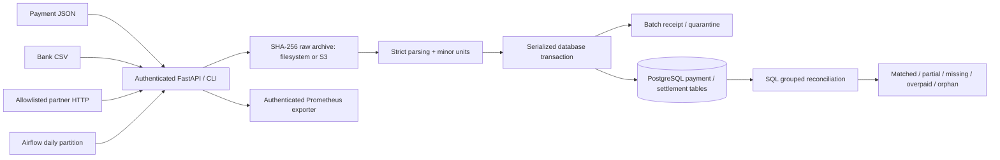

# Architecture and technical decisions

## ADR-001: exact arithmetic and explicit currency boundaries

Amounts enter as strings and are converted to integer minor units using Decimal. Net settlement plus fee is compared to the original payment amount. This models a fee withheld from payment proceeds; a different partner accounting convention needs an explicit adapter. No FX conversion is guessed. EUR settlement for a USD payment is an orphan group and the USD payment remains missing. Refunds/negative adjustments require a future explicit record type and are rejected today.

## ADR-002: preserve input before changing business state

The raw archive must acknowledge a complete object before a database transaction begins. The receipt and all new business rows then commit together. A crash between archival and commit can leave an unreferenced object; retry reuses its checksum. This sacrifices perfect cross-store atomicity in favour of recoverable evidence. Missing/corrupt archived bytes fail verification; they are never silently overwritten.

The filesystem adapter writes a private temporary file, flushes it, then links it atomically into the content-addressed namespace. POSIX also flushes the directory; Windows filesystem durability semantics differ. S3 uses `If-None-Match: *`; a 412 requires verifying the existing content.

## ADR-003: serialize writers, keep correctness simple

PostgreSQL advisory transaction lock 508172 serializes all writers. SQLite uses BEGIN IMMEDIATE. Constraints provide additional uniqueness protection. This avoids cross-worker races during duplicate/conflict validation. It limits write throughput; the benchmark exposes the cost. A future partitioned ledger would require explicit ownership of payment IDs and source row keys. Readers are not globally locked.

## ADR-004: synchronous bounded batches

HTTP handles at most 2 MB/10,000 rows and returns a durable receipt. Airflow manages scheduled retries; there is no misleading fire-and-forget background task or in-memory queue. API responses distinguish accepted, replayed and quarantined input. Replaying an identical quarantined input returns the original receipt; correcting its content creates a new batch.

## ADR-005: use managed AWS services where justified

ECS Fargate suits this small API better than operating a Kubernetes control plane. Tasks and RDS use private subnets, with no task public IP or default Internet egress. ECR, logging and Secrets Manager use interface endpoints; S3 uses a gateway endpoint. The public ALB terminates TLS and drops invalid headers. S3 uses a rotating customer-managed KMS key and scoped task permissions. Private endpoints add hourly infrastructure cost. External partner HTTP requires a separately approved outbound connector or proxy; it is intentionally unavailable from the default private AWS task network. The local simulator exercises that adapter independently. The template currently uses an RDS owner account for initial schema creation; separate migration/runtime database roles are a production hardening requirement.
