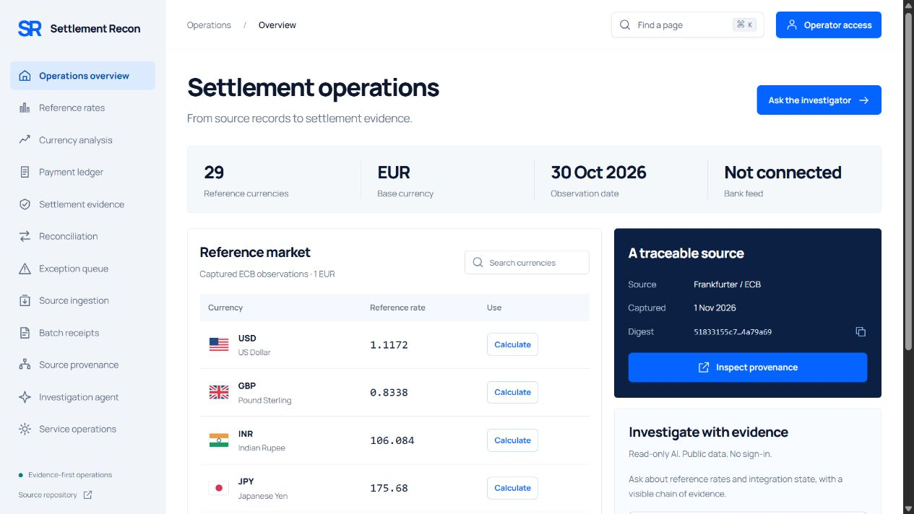
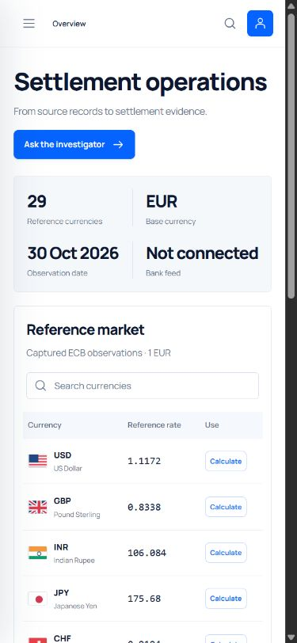
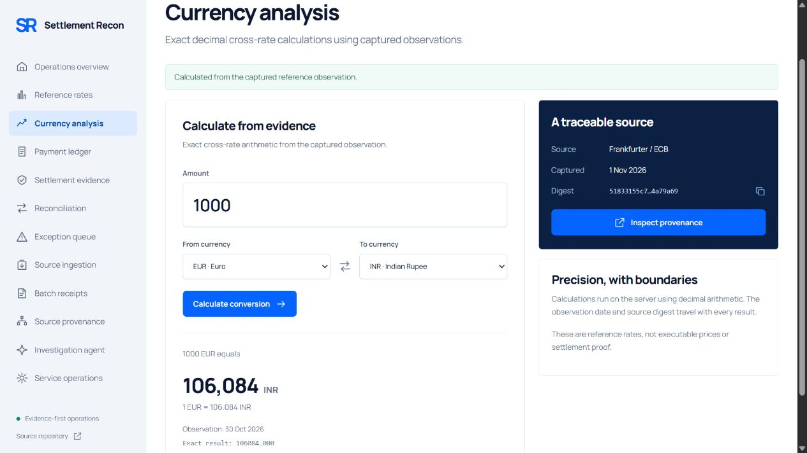
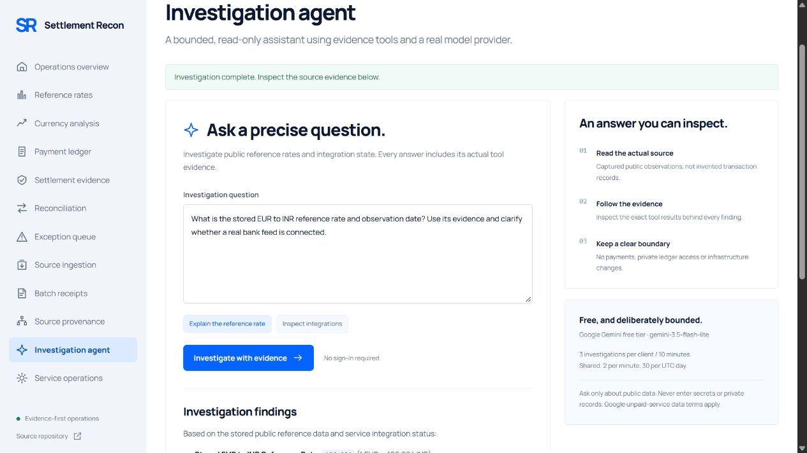

# Settlement Recon: evidence-first workspace

The selected ImageGen concept is [saved with this repository](design/settlement-concept.png). It was generated before implementation. The implemented interface uses the existing twelve-page Python/vanilla-JavaScript application; the financial and public AI APIs remain unchanged.

## Design system

- Pure white canvas, cool `#f1f5f9` navigation, navy `#0d1830` ink, cobalt `#0564ff` actions and a dark `#0c2043` source-evidence rail.
- Self-hosted Manrope variable font, source/license from Google Fonts. Geometric headings, tabular monetary presentation, consistent thin-line SVG navigation.
- A restrained 232px rail, 70px header, 30px content gutters, flat metrics band, reference table and evidence rail. Mobile uses a collapsible navigation surface and one-column workflows.
- Native dialogs for page search and evidence inspection. Visible keyboard focus, skip navigation, reduced motion and inert closed mobile navigation.

## Working workflows

1. Overview loads actual retained Frankfurter/ECB observations; all counts, dates and reference quotes are computed from the response. No financial volume, trend, availability or customer metric is invented.
2. Currency search and sorting operate on the actual returned observations. Inspect a currency to see its exact quote, capture time and source digest, then follow it into the calculator.
3. Conversion uses the existing exact-decimal server API. The browser formats its decimal string without IEEE-754 coercion, preserving values beyond Number precision. The observed date and digest remain visible.
4. Cmd/Ctrl+K searches all twelve pages with keyboard navigation. All entries navigate to real views.
5. The public investigator still uses the existing anonymous Gemini endpoint and PostgreSQL budgets. Answers are formatted into safe DOM nodes, with explicit tool evidence disclosures. No raw model HTML is executed.
6. Financial records, source ingestion, reconciliation and archive verification remain operator protected. Their views now explain the operating boundary and provide practical next steps instead of blank tables.

## Fidelity and verification

Compare sidebar/header geometry, type hierarchy, white/cool-gray/cobalt palette, live metric band, currency-table anatomy, navy source rail and workflow continuation against the concept. The monogram remains code-native and the outline icon family is rendered as scalable SVG. Table names are descriptive currencies, not provider-manufactured status claims. Exact viewport/capture limitations and final screenshots are recorded by browser QA.

Functional verification includes the source → inspection → EUR/INR calculator workflow, page-search keyboard selection, numeric sorting, mobile navigation and default/390px containment. Asset/accessibility regression tests cover all twelve pages, CSP and the bundled font; Node tests cover exact formatting beyond 53-bit integer precision. Local preview uses an actual copied public observation with its original timestamp and digest, never fabricated portfolio metrics.

No objective percentile ranking is claimed. Production source data, privacy boundaries, free provider quotas and protected workflow limitations remain visible.

## Verified production release

Runtime commit `9456799`, deployment `dpl_5PUhg3V3kJ9N73VyNZsDfoPmqxbE`, Ready at https://rohith-settlement-recon.vercel.app. Final screenshots are linked below. [Machine-readable browser QA](../evidence/ui-redesign-browser-qa.json) and [19 production HTTP checks](../evidence/ui-redesign-public-http.json) include deployed asset byte matching, original source data, protected API401 and oversized-agent-input422 without provider inference.

The production browser completed all twelve navigation views, actual INR source inspection to exact1000EUR=106084.000INR, anonymous Gemini with two evidence tools, and390px responsive containment. Mobile navigation closes with Escape and restores focus. The final console had no errors/warnings. The final local suite reports161passed,6optional PostgreSQL/MinIO skips;3Node tests passed; Ruff45files clean/formatted. An existing Starlette/httpx test-client deprecation warning remains.

Fidelity review compared palette, type hierarchy, sidebar/header, metric/table anatomy and dark evidence rail. The reference is1505x1045; actual final browser evidence is1280x720 and390x844. The native-size screenshot tool clipped height, so default-size/mobile captures are used; no pixel-perfect or percentile ranking is claimed. Source labels are intentionally simpler than reference decoration. Form fields, drawers and dialogues are implemented native controls, not screenshot overlays.
